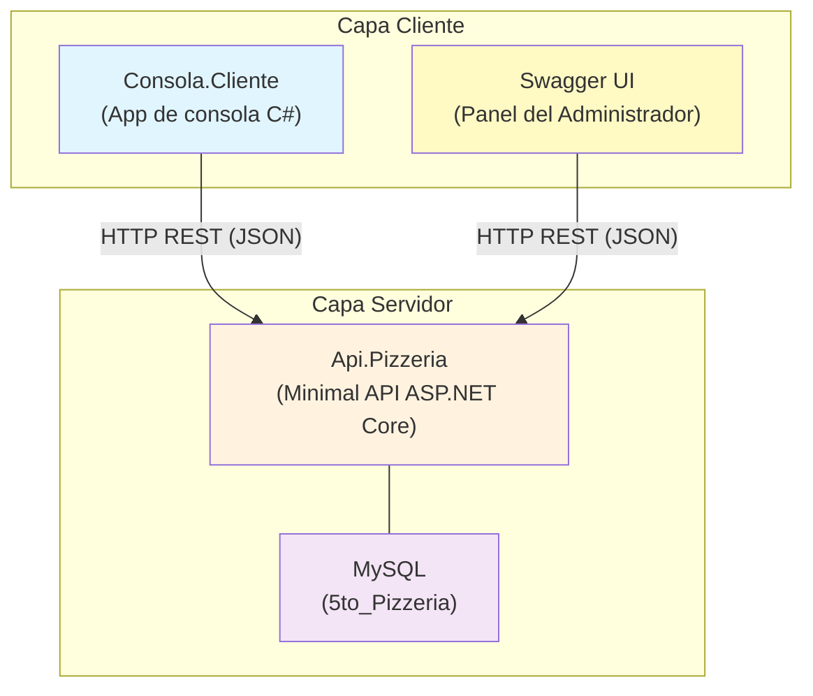

# Esquema de Arquitectura — PizzeriaAPI

**Proyecto:** "Tu app pide una pizza... y la API se la entrega"
**Curso:** Computación — ET12 DE1

---

## 1. Diagrama General de la Arquitectura

El sistema sigue el modelo **cliente-servidor** con dos procesos independientes que se comunican exclusivamente por **HTTP/JSON**:



---

## 2. Tipo de Comunicación entre Módulos

| Conexión | Protocolo | Formato | Tipo | Características |
|----------|-----------|---------|------|-----------------|
| **Consola.Cliente ↔ API** | HTTP 1.1 | JSON | Síncrona (request/response) | RESTful, stateless. El cliente siempre inicia. |
| **Swagger (Admin) ↔ API** | HTTP 1.1 | JSON | Síncrona (request/response) | Mismo mecanismo; el administrador gestiona catálogo y estados. |
| **API ↔ MySQL** | Protocolo MySQL (TCP 3306) | SQL parametrizado | Síncrona | Persistencia y transacciones con Dapper + MySqlConnector. |

### Detalle de mensajes intercambiados

#### HTTP (Cliente → API): crear pedido
```
POST /api/pedidos
Content-Type: application/json

{
  "clienteEmail": "juan.perez@email.com",
  "items": [
    { "pizzaNombre": "Pizza Muzzarella", "cantidad": 2 },
    { "pizzaNombre": "Pizza Pepperoni", "cantidad": 1 }
  ]
}

→ Response 201:
{
  "pedidoId": 42,
  "estado": "EsperaConfirmacion",
  "total": 3900.00,
  "fechaCreacion": "2026-11-18T02:00:31"
}
```

#### HTTP (Administrador → API): avanzar el ciclo de vida
```
PUT /api/pedidos/42/estado
Content-Type: application/json

{ "estado": "EnPreparacion" }

→ Response 200:
{ "pedidoId": 42, "estado": "EnPreparacion" }

→ Si la transición no es válida, Response 409:
{
  "error": "Transición inválida: no se puede pasar de 'EsperaConfirmacion' a 'Entregado'...",
  "estadoActual": "EsperaConfirmacion",
  "estadoSolicitado": "Entregado"
}
```

#### HTTP (Cliente → API): consultar estado (polling)
```
GET /api/pedidos/42

→ Response 200:
{
  "pedidoId": 42,
  "estado": "EnViaje",
  "cliente": { "id": 1, "nombre": "Juan Perez", "email": "juan.perez@email.com" },
  "items": [ { "pizza": "Pizza Muzzarella", "cantidad": 2, "precioUnitario": 1200.00 } ],
  "total": 3900.00,
  "fechaCreacion": "2026-11-18T02:00:31",
  "ultimaActualizacion": "2026-11-18T02:05:10"
}
```

---

## 3. Flujo de Mensajes y Estados

```
Tiempo     Cliente (Consola)         Backend (API)                    Administrador (Swagger)
  |          |                          |                                  |
  |          |──POST /api/pedidos─────>|                                  |
  |          |                          |── Transacción: stock + insert    |
  |          |<──201 (EsperaConfirmacion)|                                |
  |          |                          |                                  |
  |          |                          |                     PUT estado EnPreparacion ──>|
  |          |──GET /api/pedidos/42───>|                                  |
  |          |<──200 (EnPreparacion)───|                                  |
  |          |                          |                     PUT estado EnViaje ────────>|
  |          |──GET /api/pedidos/42───>|                                  |
  |          |<──200 (EnViaje)─────────|                                  |
  |          |                          |                     PUT estado Entregado ──────>|
  |          |──GET /api/pedidos/42───>|                                  |
  |          |<──200 (Entregado)───────|                                  |
  v          v                          v                                  v
```

**Asincronía por desacople de roles:** el pedido se crea en `EsperaConfirmacion` y el avance por el ciclo de vida (`EnPreparacion` → `EnViaje` → `Entregado`) lo realiza el **administrador** mediante `PUT /api/pedidos/{id}/estado`, simulando los tiempos de cocción y reparto. El cliente no bloquea: consulta el estado con `GET` periódicos (polling cada 2 segundos) hasta ver `Entregado`.

---

## 4. Máquina de Estados

```
EsperaConfirmacion ──► EnPreparacion ──► EnViaje ──► Entregado
```

- Solo están permitidas las transiciones **en orden** (una por vez).
- Repetir el estado actual es **idempotente** (200, sin cambios ni historial).
- Una transición fuera de orden devuelve **409 Conflict** sin modificar la base.

---

## 5. Resumen de Endpoints

| Método | Ruta | Propósito | Response |
|--------|------|-----------|----------|
| `POST` | `/api/clientes` | Registrar cliente | `201` + cliente |
| `GET` | `/api/clientes/{id}` | Consultar cliente por ID | `200` / `404` |
| `GET` | `/api/clientes/email/{email}` | Consultar cliente por email | `200` / `404` |
| `GET` | `/api/pizzas` | Catálogo (solo disponibles; `?todas=true` admin) | `200` |
| `POST` | `/api/pizzas` | Agregar pizza (admin) | `201` / `400` / `409` |
| `PUT` | `/api/pizzas/{id}` | Editar pizza: precio, stock, disponibilidad (admin) | `200` / `404` / `409` |
| `DELETE` | `/api/pizzas/{id}` | Eliminar pizza sin pedidos (admin) | `200` / `404` / `409` |
| `POST` | `/api/pedidos` | Crear pedido (valida y descuenta stock) | `201` / `400` |
| `GET` | `/api/pedidos/{id}` | Consultar pedido con ítems | `200` / `404` |
| `GET` | `/api/pedidos` | Listar pedidos (`?estado=` opcional) | `200` / `400` |
| `PUT` | `/api/pedidos/{id}/estado` | Avanzar estado (admin) | `200` / `400` / `404` / `409` |

---

## 6. Decisiones de Diseño

1. **HTTP como único protocolo:** cliente y administrador hablan el mismo lenguaje REST; no hay sockets ni procesos extra que mantener.
2. **Cambios de estado manuales:** el `PUT` del administrador reemplaza a los servicios automáticos de cocina/reparto, manteniendo la máquina de estados estricta como garantía de consistencia.
3. **Transacciones con descuento atómico de stock:** `UPDATE PIZZA SET stock = stock - @Cantidad WHERE id = @Id AND stock >= @Cantidad` dentro de la misma transacción del pedido; si falla, todo se revierte.
4. **Middleware global de errores:** traduce excepciones de dominio a códigos HTTP semánticos (400/404/409/500) de forma uniforme.
