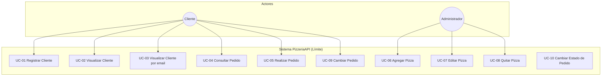

# Casos de Uso del Sistema — PizzeriaAPI

**Proyecto:** "Tu app pide una pizza... y la API se la entrega"
**Curso:** Computación — ET12 DE1

---

## 1. Diagrama General



---

## 2. Niveles de Delegación

### Delegación de Cliente
```
Cliente ──► API Pizzeria ──► Base de Datos (MySQL)
```
- **Cliente:** inicia la comunicación vía HTTP (registro, pedidos, consultas).
- **API Pizzeria:** valida reglas de negocio (FluentValidation, stock, estados).
- **Base de Datos:** persiste clientes, pizzas, pedidos e historial.

### Delegación de Administrador
```
Administrador ──► API Pizzeria ──► Base de Datos (MySQL)
```
- **Administrador:** gestiona el catálogo (altas, modificaciones, bajas) y el avance del ciclo de vida de los pedidos.
- **API Pizzeria:** valida duplicados, referencias y transiciones de estado.
- **Base de Datos:** aplica los cambios de forma transaccional.

---

## 3. Plantilla de Casos de Uso

| Campo | Valor |
|-------|-------|
| **Identificador** | UC-XX |
| **Nombre** | Nombre del caso de uso |
| **Actor Principal** | Cliente / Administrador |
| **Restricción de rol** | Canal de acceso del actor (Consola.Cliente para el Cliente; Swagger UI para el Administrador). La API no exige autenticación por consigna. |
| **Precondición** | Estado previo requerido |
| **Disparador** | Acción que inicia el flujo |
| **Postcondición** | Estado final esperado |
| **Flujo Principal** | Pasos numerados |
| **Excepciones** | Caminos alternativos con respuesta |

---

## 4. Casos de Uso del Cliente

### UC-01: Registrar Cliente
| Campo | Valor |
|-------|-------|
| **Identificador** | UC-01 |
| **Actor** | Cliente |
| **Restricción de rol** | Exclusivo del Cliente (acceso desde Consola.Cliente). La API no exige autenticación por consigna. |
| **Precondición** | El email no debe estar registrado previamente. |
| **Disparador** | El cliente desea operar en el sistema por primera vez. |
| **Postcondición** | Cliente persistido; puede crear pedidos. |

**Flujo Principal:**
1. El cliente ingresa nombre, email, teléfono y dirección.
2. El sistema valida los datos (FluentValidation): email obligatorio y con formato válido.
3. El sistema verifica que el email no exista en la base de datos.
4. El sistema registra al cliente y devuelve `201 Created` con sus datos y su `id`.

**Excepciones:**
- `400 Bad Request`: campos vacíos o email con formato inválido.
- `409 Conflict`: el email ya está registrado (restricción UNIQUE en MySQL).

**Mapeo de API:** `POST /api/clientes`

---

### UC-02: Consultar Pedido
| Campo | Valor |
|-------|-------|
| **Identificador** | UC-02 |
| **Actor** | Cliente |
| **Restricción de rol** | Exclusivo del Cliente (acceso desde Consola.Cliente). La API no exige autenticación por consigna. |
| **Precondición** | El pedido debe existir. |
| **Disparador** | El cliente quiere conocer el estado actual de su orden. |
| **Postcondición** | El cliente visualiza estado, ítems, total y fechas. |

**Flujo Principal:**
1. El cliente consulta el pedido por su `id`.
2. El sistema busca el pedido, sus ítems (con el precio unitario congelado) y el resumen del cliente.
3. El sistema devuelve `200 OK` con estado, ítems, total, `fechaCreacion` y `ultimaActualizacion`.

**Excepciones:**
- `404 Not Found`: el pedido no existe.

**Mapeo de API:** `GET /api/pedidos/{id}`

> La Consola.Cliente realiza polling con `GET` cada 2 segundos hasta que el estado sea `Entregado`.

---

### UC-03: Realizar Pedido
| Campo | Valor |
|-------|-------|
| **Identificador** | UC-03 |
| **Actor** | Cliente |
| **Restricción de rol** | Exclusivo del Cliente (acceso desde Consola.Cliente). La API no exige autenticación por consigna. |
| **Precondición** | Cliente registrado; catálogo con stock disponible. |
| **Disparador** | El cliente decide confirmar su orden. |
| **Postcondición** | Pedido creado en estado `EsperaConfirmacion`; stock descontado. |

**Flujo Principal:**
1. El cliente envía su email y la lista de ítems (nombre de pizza + cantidad).
2. El sistema valida el request (al menos un ítem, cantidades positivas).
3. El sistema verifica que el cliente exista y resuelve las pizzas por nombre.
4. **`<<Include>> Verificar Stock`**: dentro de una transacción, el sistema descuenta atómicamente `stock = stock - cantidad` para cada pizza (solo si el stock alcanza y la pizza está disponible).
5. El sistema registra `PEDIDO` (estado `EsperaConfirmacion`), los `ITEM_PEDIDO` con el precio unitario congelado y el `HISTORIAL_ESTADO_PEDIDO`.
6. La transacción se confirma y el sistema devuelve `201 Created` con `pedidoId`, estado y total.

**Excepciones:**
- `400 Bad Request`: ítems vacíos, cantidad inválida, cliente inexistente, pizza inexistente, pizza no disponible o stock insuficiente (la transacción se revierte y no se persiste nada).

**Mapeo de API:** `POST /api/pedidos`

---

## 5. Casos de Uso del Administrador

### UC-04: Agregar Pizza
| Campo | Valor |
|-------|-------|
| **Identificador** | UC-04 |
| **Actor** | Administrador |
| **Restricción de rol** | Exclusivo del Administrador (acceso desde Swagger UI). La API no exige autenticación por consigna. |
| **Precondición** | No debe existir una pizza con el mismo nombre. |
| **Disparador** | Se incorpora un nuevo producto al menú. |
| **Postcondición** | Pizza disponible en el catálogo con su stock inicial. |

**Flujo Principal:**
1. El administrador ingresa nombre, tamaño, precio, descripción y stock inicial.
2. El sistema valida los campos (nombre y tamaño obligatorios, precio mayor a 0, stock no negativo).
3. El sistema verifica la unicidad del nombre.
4. El sistema inserta la pizza y devuelve `201 Created`.

**Excepciones:**
- `400 Bad Request`: campos inválidos.
- `409 Conflict`: el nombre ya existe en el catálogo.

**Mapeo de API:** `POST /api/pizzas`

---

### UC-05: Editar Pizza
| Campo | Valor |
|-------|-------|
| **Identificador** | UC-05 |
| **Actor** | Administrador |
| **Restricción de rol** | Exclusivo del Administrador (acceso desde Swagger UI). La API no exige autenticación por consigna. |
| **Precondición** | La pizza debe existir. |
| **Disparador** | Cambio de precio, de stock o de disponibilidad. |
| **Postcondición** | Catálogo actualizado. |

**Flujo Principal:**
1. El administrador envía los nuevos valores (precio, descripción, stock, `disponible`).
2. El sistema valida y verifica que el nombre (si cambia) no duplique a otro.
3. El sistema actualiza el registro y devuelve `200 OK` con la pizza actualizada.

**Excepciones:**
- `400 Bad Request`: datos inválidos.
- `404 Not Found`: la pizza no existe.
- `409 Conflict`: el nuevo nombre ya pertenece a otra pizza.

**Mapeo de API:** `PUT /api/pizzas/{id}`

> Bajar `disponible` a `false` es el mecanismo recomendado para retirar un producto del menú sin romper pedidos históricos.

---

### UC-06: Quitar Pizza
| Campo | Valor |
|-------|-------|
| **Identificador** | UC-06 |
| **Actor** | Administrador |
| **Restricción de rol** | Exclusivo del Administrador (acceso desde Swagger UI). La API no exige autenticación por consigna. |
| **Precondición** | La pizza existe y no integra ningún pedido. |
| **Disparador** | Un producto se retira definitivamente del sistema. |
| **Postcondición** | La pizza ya no existe en el catálogo. |

**Flujo Principal:**
1. El administrador solicita la eliminación de una pizza.
2. El sistema verifica que la pizza no tenga ítems de pedido asociados.
3. El sistema elimina la pizza y devuelve `200 OK`.

**Excepciones:**
- `404 Not Found`: la pizza no existe.
- `409 Conflict`: la pizza tiene ítems asociados; se sugiere usar `PUT` y marcar `disponible = false` en su lugar.

**Mapeo de API:** `DELETE /api/pizzas/{id}`

---

### UC-07: Cambiar Estado de Pedido
| Campo | Valor |
|-------|-------|
| **Identificador** | UC-07 |
| **Actor** | Administrador |
| **Restricción de rol** | Exclusivo del Administrador (acceso desde Swagger UI). La API no exige autenticación por consigna. |
| **Precondición** | El pedido existe y está en un estado anterior al solicitado. |
| **Disparador** | La cocina/reparto confirman un avance real (simulado por el admin). |
| **Postcondición** | El pedido avanza un paso en su ciclo de vida. |

**Flujo Principal:**
1. El administrador envía el nuevo estado: `EnPreparacion`, `EnViaje` o `Entregado`.
2. El sistema valida que el estado sea una transición válida y estrictamente secuencial.
3. El sistema actualiza `PEDIDO` y registra el cambio en `HISTORIAL_ESTADO_PEDIDO` dentro de una transacción.
4. El sistema devuelve `200 OK` con `pedidoId` y nuevo estado.

**Excepciones:**
- `400 Bad Request`: el estado enviado no existe en la enumeración.
- `404 Not Found`: el pedido no existe.
- `409 Conflict`: transición fuera de orden (p. ej. `EsperaConfirmacion` → `Entregado`); se informa `estadoActual` y `estadoSolicitado`.

**Mapeo de API:** `PUT /api/pedidos/{id}/estado`

> Transición idempotente: enviar el estado actual nuevamente devuelve `200` sin efectos colaterales.

---

## 6. Resumen de Respuestas por Caso de Uso

| Caso de Uso | Actor | Endpoint | Éxito | Errores |
|-------------|-------|----------|-------|---------|
| UC-01 Registrar Cliente | Cliente | `POST /api/clientes` | 201 | 400, 409 |
| UC-02 Consultar Pedido | Cliente | `GET /api/pedidos/{id}` | 200 | 404 |
| UC-03 Realizar Pedido | Cliente | `POST /api/pedidos` | 201 | 400 |
| UC-04 Agregar Pizza | Administrador | `POST /api/pizzas` | 201 | 400, 409 |
| UC-05 Editar Pizza | Administrador | `PUT /api/pizzas/{id}` | 200 | 400, 404, 409 |
| UC-06 Quitar Pizza | Administrador | `DELETE /api/pizzas/{id}` | 200 | 404, 409 |
| UC-07 Cambiar Estado | Administrador | `PUT /api/pedidos/{id}/estado` | 200 | 400, 404, 409 |
