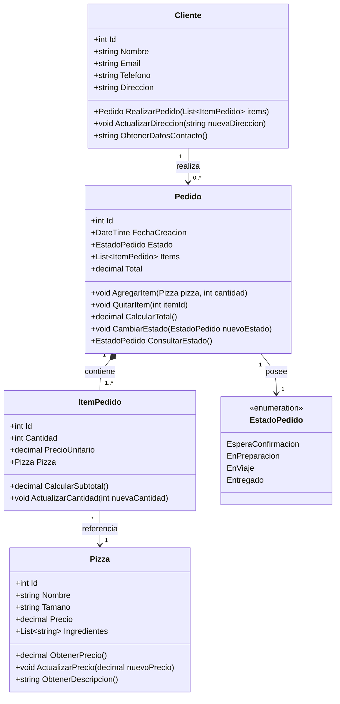
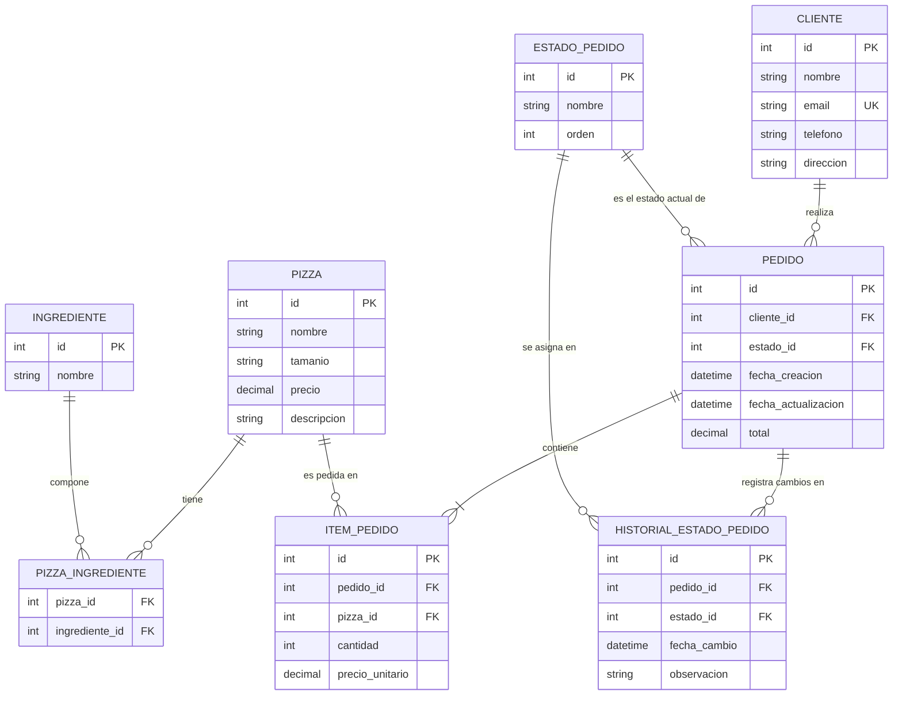

# Relevamiento y Diseño Estructurado — Actividad 2
**Proyecto:** "Tu app pide una pizza... y la API se la entrega"
**Curso:** Computación — ET12 DE1

---

## 1. Relevamiento Funcional

### 1.1 Límites del Sistema y Actores
De acuerdo al diagrama de casos de uso del sistema, se identifican los siguientes **Actores** que interactúan con el **Límite del Sistema (Pizzería / API Backend)**:

| Actor | Rol | Canal de Comunicación |
| :--- | :--- | :--- |
| **Cliente** | Usuario final que consulta las pizzas disponibles, arma su pedido, modifica ítems si lo requiere y realiza la orden de compra. | Aplicación Cliente / Web → API REST (HTTP) |
| **Administrador** | Encargado del mantenimiento del catálogo comercial: incorpora nuevas pizzas, retira productos discontinuados y gestiona los precios. | Panel de Administración → API REST (HTTP) |

> **Nota de Análisis:** El Backend/API actúa como el límite del sistema que procesa las peticiones de ambos actores, valida las reglas de negocio y garantiza la persistencia en la base de datos.

### 1.2 Entidades de Negocio
Para asegurar que el sistema soporte pedidos reales y mantenga la consistencia de los datos, se definen las siguientes entidades:

* **Cliente:** Contiene los datos de identificación y localización del usuario final. Por diseño solicitado en la consigna, **no posee contraseña ni lógica de autenticación**.
* **Pizza:** Actúa como catálogo de productos disponibles en la pizzería (Nombre, Tamaño, Precio base).
* **ItemPedido (Entidad de Soporte):** Representa la línea intermedia que desacopla la Pizza del Pedido. Permite solicitar múltiples cantidades de una misma pizza y congelar el `precio_unitario` histórico al momento de la compra.
* **Pedido:** Entidad central que unifica al Cliente, la lista de Items y el estado del ciclo de vida de la orden.
* **EstadoPedido (Enumerador):** Define estrictamente los estados requeridos en la consigna: `EsperaConfirmacion`, `EnPreparacion`, `EnViaje`, `Entregado`.

### 1.3 Ciclo de Vida del Pedido (Máquina de Estados)
* **EsperaConfirmacion → EnPreparacion:** Se produce una vez verificado el stock y confirmada la orden por parte del sistema para su elaboración.
* **EnPreparacion → EnViaje:** Ocurre cuando el pedido finaliza su tiempo de cocción y pasa a logística de distribución.
* **EnViaje → Entregado:** Fin del ciclo de vida, al confirmarse la entrega efectiva del pedido en el domicilio del cliente.

---

## 2. Diagrama de Clases UML — Actividad 3

Este diagrama modela las clases del dominio orientadas a objetos para el sistema de pedidos de la pizzería, cumpliendo estrictamente con los requerimientos de la consigna. Se representan como mínimo las clases **Cliente**, **Pizza** y **Pedido**, incorporando la clase de soporte **ItemPedido** y la enumeración **EstadoPedido**, con sus respectivos atributos, métodos de negocio y relaciones estructurales.



### 2.1 Descripción de Elementos del Modelo

* **`Cliente`**: Modela al cliente que realiza pedidos. Posee atributos de identificación y localización, y métodos para solicitar nuevos pedidos o actualizar sus datos de entrega.
* **`Pizza`**: Representa el producto que ofrece la pizzería (con nombre, tamaño, precio e ingredientes) y métodos para consultar su información y tarifario.
* **`ItemPedido`**: Entidad de soporte que desacopla la Pizza del Pedido, encapsulando la cantidad solicitada, el precio unitario pactado y el cálculo de subtotales (`Cantidad * PrecioUnitario`).
* **`Pedido`**: Entidad central que nuclea al cliente, la lista de ítems solicitados y el ciclo de vida del pedido mediante sus métodos de cálculo de total y transición de estados.
* **`EstadoPedido`**: Enumerador que contempla de forma exclusiva los cuatro estados especificados en la consigna:
  1. `EsperaConfirmacion` (*Espera de confirmación*)
  2. `EnPreparacion` (*En preparación*)
  3. `EnViaje` (*En viaje*)
  4. `Entregado` (*Entregado*)

---

## 3. Modelo de Datos Relacional

A continuación se presenta el modelo de entidades y relaciones para la base de datos:



## 4. Diagramas de Secuencia (Basados en Casos de Uso)

Los siguientes diagramas de secuencia modelan la dinámica temporal y los intercambios de mensajes entre los actores (**Cliente** y **Administrador**), el **Backend (API)** y la **Base de Datos**, reflejando fielmente las especificaciones de los casos de uso del sistema.

---

### 4.1 Diagrama de Secuencia: Caso de Uso "Hacer Pedido" (Actor: Cliente)

Modela el flujo completo desde la visualización del menú, la conformación del carrito, la extensión `<<Extend>> Modificar pedido` y la inclusión obligatoria `<<Include>> Verificar Stock` antes de la confirmación y persistencia del pedido:

```mermaid
sequenceDiagram
    autonumber
    actor Cliente as Cliente
    participant Sistema as Sistema Pizzería (API)
    database BD as Base de Datos / Stock

    %% 1. Ver pizzas
    Cliente->>Sistema: 1. Consultar catálogo de pizzas ("Ver pizzas")
    activate Sistema
    Sistema->>BD: Consultar pizzas activas y precios
    activate BD
    BD-->>Sistema: Lista de pizzas disponibles
    deactivate BD
    Sistema-->>Cliente: Mostrar catálogo de pizzas disponibles
    deactivate Sistema

    %% 2. Añadir al carrito
    Cliente->>Sistema: 2. Seleccionar pizzas y cantidades (Añadir al carrito)
    activate Sistema
    Sistema-->>Cliente: Carrito actualizado con los ítems solicitados
    deactivate Sistema

    %% Alternativa: Modificar pedido (<<Extend>>)
    opt <<Extend>> Modificar Pedido
        Cliente->>Sistema: Agregar/quitar unidades o cambiar pizzas
        activate Sistema
        Sistema->>Sistema: Recalcular subtotales del carrito
        Sistema-->>Cliente: Carrito modificado y total recalculado
        deactivate Sistema
    end

    %% 3. Solicitar confirmación
    Cliente->>Sistema: 3. Confirmar pedido (Enviar orden)
    activate Sistema

    %% 4. Inclusión: Verificar Stock (<<Include>>)
    rect rgb(240, 245, 255)
        Note over Sistema, BD: <<Include>> Verificar Stock
        Sistema->>BD: Comprobar disponibilidad de pizzas e ingredientes
        activate BD
        BD-->>Sistema: Resultado de disponibilidad de stock
        deactivate BD
    end

    %% 5 & 6. Evaluación de Stock y Resultado
    alt Stock disponible (Flujo Principal)
        Sistema->>BD: Registrar Pedido (Estado: EsperaConfirmacion / EnPreparacion)
        activate BD
        Sistema->>BD: Descontar stock e ingredientes utilizados
        BD-->>Sistema: Pedido registrado con éxito (Id generado)
        deactivate BD
        Sistema-->>Cliente: Mensaje de éxito, resumen del pedido y total a pagar
    else Stock insuficiente (Excepción)
        Sistema-->>Cliente: Notificar producto sin stock (Permite modificar carrito o cancelar)
    end
    deactivate Sistema
```

#### Descripción del Flujo "Hacer Pedido":
1. **Consulta del Menú:** El cliente ejecuta el caso de uso *Ver pizzas* para explorar los productos y precios disponibles.
2. **Armado de la Orden:** Agrega las pizzas seleccionadas al carrito de compras.
3. **Modificación Opcional (`<<Extend>>`):** Si el cliente decide realizar cambios previos a la confirmación, se activa el caso de uso *Modificar pedido*, recalculando los montos.
4. **Verificación de Stock (`<<Include>>`):** Al solicitar la confirmación, el sistema ejecuta de manera obligatoria el caso de uso *Verificar stock* contra la base de datos.
5. **Postcondición:** Con stock favorable, el pedido se persiste formalmente (avanzando a su preparación), se descuenta el inventario y se entrega el resumen al cliente.

---

### 4.2 Diagrama de Secuencia: Casos de Uso del Administrador ("Agregar / Quitar Pizzas" y "Gestionar Precios")

Modela las operaciones de administración del catálogo comercial, contemplando las validaciones de negocio (campos obligatorios, prevención de nombres duplicados y restricción de eliminación ante pedidos activos):

```mermaid
sequenceDiagram
    autonumber
    actor Admin as Administrador
    participant Sistema as Sistema Pizzería (API)
    database BD as Base de Datos

    Admin->>Sistema: 1. Ingresar a sección de gestión del menú
    activate Sistema
    Sistema->>BD: Consultar lista actual de pizzas
    activate BD
    BD-->>Sistema: Catálogo actual de pizzas y precios
    deactivate BD
    Sistema-->>Admin: Mostrar listado de pizzas
    deactivate Sistema

    alt Acción A: Agregar nueva pizza
        Admin->>Sistema: 2a. Enviar datos de nueva pizza (Nombre, ingredientes, tamaño, precio)
        activate Sistema
        Sistema->>Sistema: Validar datos obligatorios completos
        alt Datos válidos y nombre no duplicado
            Sistema->>BD: Verificar si ya existe pizza con mismo nombre
            activate BD
            BD-->>Sistema: No existe duplicado
            Sistema->>BD: Insertar nueva pizza en catálogo
            BD-->>Sistema: Registro exitoso
            deactivate BD
            Sistema-->>Admin: Confirmación: Pizza agregada exitosamente al catálogo
        else Error de validación o duplicado (Excepción)
            Sistema-->>Admin: Error: Campos incompletos o nombre de pizza ya existente
        end
        deactivate Sistema

    else Acción B: Quitar pizza existente
        Admin->>Sistema: 2b. Solicitar eliminación de una pizza del menú
        activate Sistema
        Sistema->>BD: Verificar si la pizza integra pedidos activos ("EnPreparacion")
        activate BD
        BD-->>Sistema: Estado de pedidos vinculados
        deactivate BD
        alt Sin pedidos activos vinculados
            Sistema->>BD: Eliminar pizza del catálogo (o marcar como inactiva)
            activate BD
            BD-->>Sistema: Eliminación exitosa
            deactivate BD
            Sistema-->>Admin: Confirmación: Pizza retirada del menú comercial
        else Tiene pedidos activos en curso (Excepción)
            Sistema-->>Admin: Rechazar eliminación directa (Sugerir pausar/ocultar del menú)
        end
        deactivate Sistema

    else Acción C: Gestionar precios
        Admin->>Sistema: 2c. Actualizar precio de una pizza (IdPizza, NuevoPrecio)
        activate Sistema
        Sistema->>BD: Actualizar precio en catálogo
        activate BD
        BD-->>Sistema: Precio actualizado
        deactivate BD
        Sistema-->>Admin: Confirmación: Precio actualizado en el menú
        deactivate Sistema
    end
```

#### Descripción del Flujo "Gestión del Administrador":
1. **Acceso al Catálogo:** El administrador accede al panel y obtiene el listado de productos registrados.
2. **Agregar Pizza:** Se validan los atributos obligatorios y la unicidad del nombre antes de persistir la nueva variedad en el catálogo.
3. **Quitar Pizza:** Se asegura la integridad referencial y de negocio impidiendo la eliminación física de pizzas que formen parte de pedidos en curso.
4. **Gestionar Precios:** Permite ajustar el tarifario de las pizzas de forma inmediata en el sistema.
